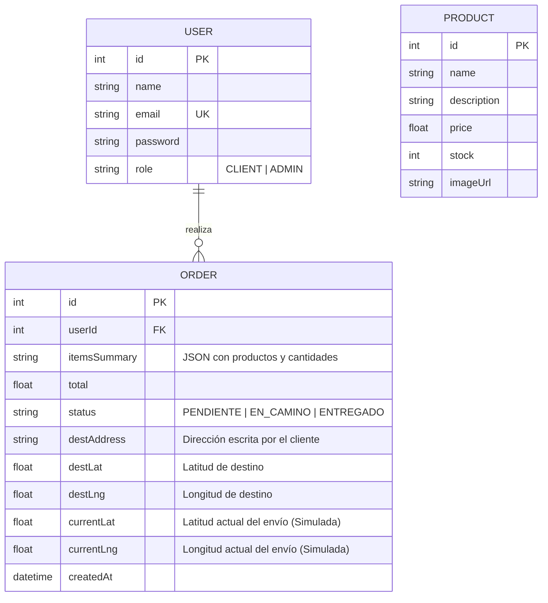

# Documentación Técnica y Funcional: SmartDelivery

**Proyecto:** Sistema de Gestión de Pedidos y Seguimiento en Tiempo Real  
**Contexto:** Concurso de Programación Competitiva XCODE 2026 – Fase Final  
**Tiempo estimado de implementación:** 90 minutos (Arquitectura MVP Optimizada)

---

## 1. Visión General del Sistema

**SmartDelivery** es una aplicación web Full Stack diseñada para una tienda de productos tecnológicos. Permite a los clientes adquirir productos e indicar la ubicación de entrega en un mapa interactivo, mientras que la tienda administra el catálogo, gestiona los pedidos y actualiza tanto el estado como la ubicación geográfica del reparto.

Para garantizar que el proyecto se culmine con éxito en **1 hora y 30 minutos**, la arquitectura ha sido optimizada eliminando complejidades innecesarias (como pasarelas de pago reales, carritos persistentes en base de datos o múltiples tablas intermedias de envíos) sin sacrificar **ningún punto de la rúbrica de evaluación**.

---

## 2. Stack Tecnológico Definido (Enfoque *Rapid Prototyping*)

Se ha seleccionado un stack ligero que no requiere configuraciones externas complejas ni llaves de API de pago (tarjetas de crédito):

*   **Frontend:** React.js (con Vite) + Tailwind CSS (diseño rápido) + Lucide React (iconos).
*   **Motor de Mapas (20 pts):** **Leaflet.js (`react-leaflet`) con OpenStreetMap**. 
    * *Justificación técnica:* A diferencia de Google Maps o Mapbox, Leaflet es 100% gratuito, no requiere configurar cuentas de facturación ni API Keys, y permite capturar clics en el mapa y trazar rutas (`Polyline`) en menos de 20 líneas de código.
*   **Backend:** Node.js con Express.js (API RESTful).
*   **Base de Datos:** **SQLite** gestionado con **Prisma ORM** (o `better-sqlite3`).
    * *Justificación técnica:* Se almacena en un archivo local (`dev.db`), evitando caídas de conexión a la nube y configuraciones de servidores pesados como PostgreSQL o MySQL.
*   **Seguridad y Autenticación (15 pts):** JSON Web Tokens (`jsonwebtoken`) para sesiones stateless y validación de roles mediante middlewares.

---

## 3. Modelo Prototipo de Base de Datos (Simplificado a 3 Entidades)

Para ahorrar tiempo en consultas `JOIN` y controladores adicionales, **fusionamos la entidad Pedido (`Order`) y Envío (`Shipment`) en una sola tabla**, y almacenamos el detalle de productos comprados como un campo JSON o texto descriptivo.

### Diagrama Entidad-Relación

### Diccionario de Coordenadas Geográficas
*   **Ubicación Fija de la Tienda (Constante del Sistema):** Por defecto se centrará en Lima (ej. $Lat = -12.0464$, $Lng = -77.0428$). Todo pedido nuevo inicia con `currentLat` y `currentLng` iguales a las coordenadas de la tienda.

---

## 4. Historias de Usuario (Mapeadas a la Rúbrica)

### Rol: Autenticación (Común)
*   **HU-01 (Registro y Login):** Como usuario, quiero registrarme e iniciar sesión seleccionando mi rol (`CLIENT` o `ADMIN` para pruebas rápidas del jurado) para obtener un token JWT que proteja mis vistas.

### Rol: Cliente (`CLIENT`)
*   **HU-02 (Catálogo y Compra):** Como cliente, quiero ver la lista de productos tecnológicos disponibles y agregarlos a mi pedido rápido.
*   **HU-03 (Registro de Destino en Mapa):** Como cliente, al confirmar mi pedido, quiero escribir mi dirección y hacer clic en un mapa interactivo para fijar las coordenadas exactas ($Lat, Lng$) de mi domicilio.
*   **HU-04 (Seguimiento de Envío):** Como cliente, quiero ver una lista de mis pedidos y, al seleccionar uno, visualizar en un mapa un marcador para la **Tienda**, un marcador para mi **Destino**, un marcador con la **Ubicación Actual del repartidor** y una línea que trace la ruta.

### Rol: Tienda / Administrador (`ADMIN`)
*   **HU-05 (Gestión de Productos):** Como tienda, quiero un formulario simple para crear nuevos productos tecnológicos (nombre, precio, stock, imagen) y listarlos.
*   **HU-06 (Panel de Pedidos y Simulación GPS):** Como tienda, quiero ver todos los pedidos de los clientes, cambiar su estado (`PENDIENTE` $\rightarrow$ `EN_CAMINO` $\rightarrow$ `ENTREGADO`) y actualizar las coordenadas actuales del envío (haciendo clic en el mapa o mediante un botón de "Simular Avance") para que el cliente vea el progreso.

---

## 5. Especificación de la API REST (Endpoints)

Todos los endpoints protegidos requieren el header `Authorization: Bearer <token>`.

### Módulo 1: Autenticación (`/api/auth`)
| Método | Endpoint | Rol Requerido | Descripción | Body (JSON) |
| :--- | :--- | :--- | :--- | :--- |
| `POST` | `/api/auth/register` | Público | Registra un usuario y retorna JWT | `{ name, email, password, role }` |
| `POST` | `/api/auth/login` | Público | Valida credenciales y retorna JWT + Rol | `{ email, password }` |

### Módulo 2: Productos (`/api/products`)
| Método | Endpoint | Rol Requerido | Descripción | Body (JSON) |
| :--- | :--- | :--- | :--- | :--- |
| `GET` | `/api/products` | Autenticado | Lista todos los productos tecnológicos | *Ninguno* |
| `POST` | `/api/products` | `ADMIN` | Crea un nuevo producto en la tienda | `{ name, price, stock, imageUrl }` |
| `DELETE`| `/api/products/:id`| `ADMIN` | Elimina un producto | *Ninguno* |

### Módulo 3: Pedidos, Envíos y Mapa (`/api/orders`)
| Método | Endpoint | Rol Requerido | Descripción | Body (JSON) |
| :--- | :--- | :--- | :--- | :--- |
| `POST` | `/api/orders` | `CLIENT` | Crea pedido con coordenadas de destino. Inicializa `currentLat/Lng` en la tienda. | `{ itemsSummary, total, destAddress, destLat, destLng }` |
| `GET` | `/api/orders` | Ambos | Si es `CLIENT`, devuelve sus pedidos. Si es `ADMIN`, devuelve todos los pedidos del sistema. | *Ninguno* |
| `PATCH` | `/api/orders/:id/tracking` | `ADMIN` | Actualiza el estado del pedido y las coordenadas actuales del paquete. | `{ status, currentLat, currentLng }` |

---

## 6. Funcionamiento Detallado de la Lógica del Mapa (Criterio de 20 Puntos)

El requerimiento más valorado en la rúbrica (20 puntos) es la **Integración del mapa y seguimiento de envíos**. Funcionará bajo el siguiente flujo mecánico muy fácil de programar:

1.  **Constante Global de Tienda:**
    Definimos una constante en Frontend y Backend:
    $$\text{STORE\_COORDS} = [-12.0464, -77.0428]$$
2.  **Captura de Destino (Vista Cliente):**
    *   El cliente abre el formulario de "Realizar Pedido".
    *   Se renderiza un `<MapContainer>` de Leaflet centrado en $\text{STORE\_COORDS}$.
    *   Usando el hook `useMapEvents({ click(e) })` de `react-leaflet`, cuando el cliente hace clic en cualquier calle del mapa, se capturan `e.latlng.lat` y `e.latlng.lng` y se guardan en el estado del formulario como destino.
3.  **Visualización de Ruta y Seguimiento (Vista Cliente y Tienda):**
    Al abrir el detalle de un pedido, el mapa dibuja **3 Marcadores (`<Marker>`)** y **1 Línea de Ruta (`<Polyline>`)**:
    *   **Marcador 1 (Tienda):** Fijo en `STORE_COORDS`.
    *   **Marcador 2 (Paquete / Repartidor):** Dinámico en `[order.currentLat, order.currentLng]`.
    *   **Marcador 3 (Cliente / Destino):** Fijo en `[order.destLat, order.destLng]`.
    *   **Línea de Ruta (`Polyline`):** Un array de coordenadas que une los tres puntos:
        $$\text{Ruta} = [\text{STORE\_COORDS}, [\text{currentLat}, \text{currentLng}], [\text{destLat}, \text{destLng}]]$$
4.  **Simulación de Coordenadas en 1 Clic (Vista Tienda):**
    Para que el jurado vea el movimiento fácilmente sin que tengas que digitar latitudes a mano, el panel de la Tienda tendrá dos formas de actualizar la ubicación del envío:
    *   **Opción A (Clic directo):** El administrador hace clic en cualquier punto del mapa del pedido y presiona "Mover repartidor aquí".
    *   **Opción B (Botones de Interpolación Rápida):**
        *   *Botón "En Tienda (0%)":* Fija `current` = `STORE_COORDS` y estado `PENDIENTE`.
        *   *Botón "En Camino - Mitad de ruta (50%)":* Calcula el punto medio matemático y cambia el estado a `EN_CAMINO`:
            $$Lat_{actual} = \frac{Lat_{tienda} + Lat_{destino}}{2}, \quad Lng_{actual} = \frac{Lng_{tienda} + Lng_{destino}}{2}$$
        *   *Botón "Entregado en Destino (100%)":* Fija `current` = `dest` y cambia el estado a `ENTREGADO`.

---

## 7. Flujo de Pantallas (Wireframes Lógicos)

Para construir el Frontend en menos de 40 minutos, utiliza una **Single Page Application (SPA)** con renderizado condicional basado en el estado del usuario (sin complicarte con muchas rutas de React Router):

1.  **Vista 1: `AuthView` (Si no hay token)**
    *   Formulario único con switch entre "Iniciar Sesión" y "Registrarse".
    *   Selector visible de Rol (`Cliente` / `Tienda`) durante el registro para facilitar la evaluación del jurado.
2.  **Vista 2: `ClientDashboard` (Si `user.role === 'CLIENT'`)**
    *   **Columna Izquierda (Catálogo y Checkout):** Tarjetas de productos con botón "Agregar". Abajo, resumen del pedido, input de dirección, mini-mapa para hacer clic en el destino y botón "Confirmar Pedido".
    *   **Columna Derecha (Mis Pedidos y Tracking):** Lista de pedidos realizados. Al hacer clic en "Ver Seguimiento", se despliega el mapa principal mostrando la Tienda, la Ubicación Actual del envío, el Destino y la barra de estado (`PENDIENTE` | `EN_CAMINO` | `ENTREGADO`).
3.  **Vista 3: `AdminDashboard` (Si `user.role === 'ADMIN'`)**
    *   **Pestaña 1: Gestión de Pedidos y Mapa:** Tabla con todos los pedidos. Al seleccionar uno, se abre el mapa interactivo con los botones de estado y simulación de coordenadas ("En Tienda", "Avanzar 50%", "Entregado" o clic libre en el mapa).
    *   **Pestaña 2: Gestión de Productos:** Formulario simple de 4 campos (Nombre, Precio, Stock, URL de imagen) y tabla de productos existentes.